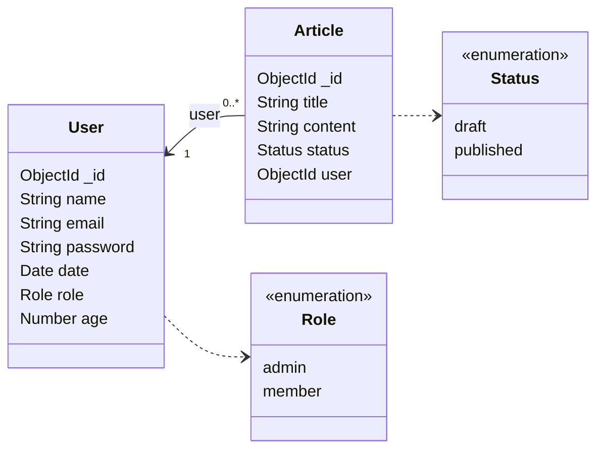

# Étude de cas – Création de l'API des articles

## Installation

1. Démarrer MongoDB (`mongodb://localhost:27017/myapp`)
2. Installer et lancer le projet :

```bash
npm install
npm run serve
```

L'application est disponible sur http://localhost:3000

Lancer les tests :

```bash
npm test
```

## 1. Diagramme UML de la base de données



Un utilisateur peut écrire plusieurs articles, un article appartient à un seul utilisateur (champ `user` qui référence `User._id`).

| Collection | Champ      | Contraintes                                        |
| ---------- | ---------- | -------------------------------------------------- |
| users      | `email`    | requis, unique, enregistré en minuscules           |
| users      | `password` | requis, 8 caractères minimum, hashé avec bcrypt    |
| users      | `date`     | valeur par défaut : `Date.now`                     |
| users      | `role`     | énumération : `admin`, `member`                    |
| articles   | `status`   | énumération : `draft`, `published` (défaut `draft`) |
| articles   | `user`     | référence vers `users._id`                         |

## Endpoints

L'authentification se fait avec le header `x-access-token` (token récupéré avec `POST /login`).

| Méthode | URL                           | Accès          | Description                                                        |
| ------- | ----------------------------- | -------------- | ------------------------------------------------------------------ |
| POST    | `/api/articles`               | connecté       | Crée un article, l'auteur est l'utilisateur connecté               |
| PUT     | `/api/articles/:id`           | admin          | Modifie un article                                                 |
| DELETE  | `/api/articles/:id`           | admin          | Supprime un article                                                |
| GET     | `/api/users/:userId/articles` | public         | Articles d'un utilisateur avec ses informations (sans mot de passe) |

Événements temps réel (socket.io) : `article:create`, `article:update`, `article:delete`.

## Déploiement avec PM2

Configuration dans `ecosystem.config.js` :

- logs d'erreur enregistrés dans `logs/err.log` (`error_file`)
- redémarrage si la mémoire dépasse 200 Mo (`max_memory_restart: "200M"`)

Commande pour lancer l'application avec 3 instances en parallèle :

```bash
pm2 start ecosystem.config.js -i 3
```

En production :

```bash
pm2 start ecosystem.config.js -i 3 --env production
```
